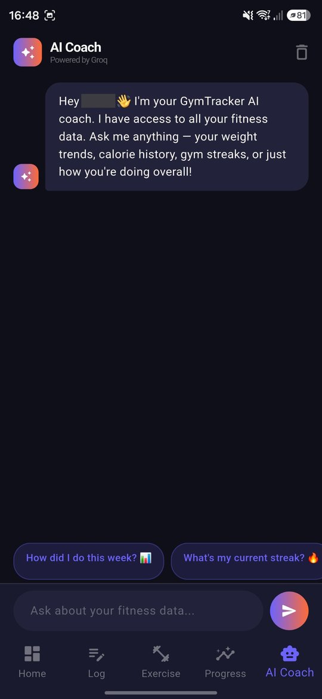
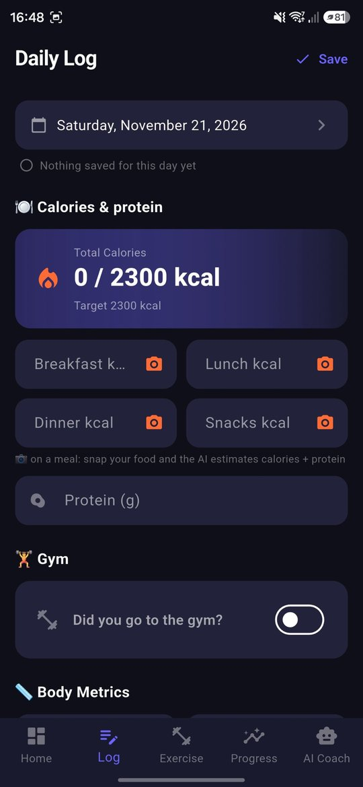
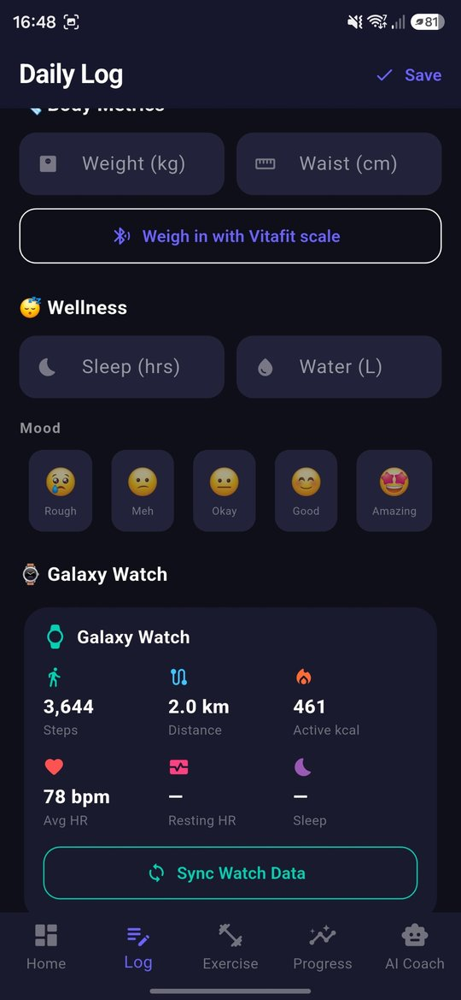
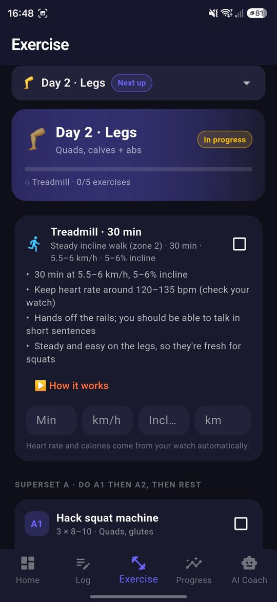

# GymTracker

A personal fitness app I built and self-host: a **Flutter Android app** for logging food, workouts and body measurements, a **FastAPI backend** running in Docker on my Proxmox cluster, automatic **Galaxy Watch** data through Health Connect, and an **AI coach** that answers questions about my own data.

| AI coach | Daily log | Watch data | Workout plan |
|---|---|---|---|
|  |  |  |  |

> Screens are from my own install; personal health numbers aren't shown in this repo.

---

## Contents
1. [What it does](#1-what-it-does)
2. [Architecture](#2-architecture)
3. [The backend](#3-the-backend)
4. [The Android app](#4-the-android-app)
5. [Deploy the backend on Proxmox](#5-deploy-the-backend-on-proxmox)
6. [Monitoring and backups](#6-monitoring-and-backups)
7. [Problems I hit and how I fixed them](#7-problems-i-hit-and-how-i-fixed-them)
8. [Security](#8-security)
9. [Roadmap](#9-roadmap)

---

## 1. What it does

| Area | Features |
|---|---|
| **Daily log** | Calories per meal (breakfast / lunch / dinner / snacks), protein, gym yes/no, weight, waist, sleep, water, mood, notes |
| **Food photos** | Snap a meal → a vision model estimates calories and protein |
| **Workouts** | A built-in split (Push / Legs / …) with supersets, per-set weight × reps, treadmill sessions, "best lifts" history |
| **Watch** | Steps, distance, active calories, heart rate (avg / resting), sleep and workouts from a Samsung Galaxy Watch, synced automatically every night |
| **Smart scale** | Weight, body fat %, muscle, water, bone mass, BMR from a Bluetooth scale |
| **Reports** | Weekly and monthly reports with a 0–100 performance score, streaks, achievements, gym-consistency heatmap |
| **AI coach** | Chat that reads your own logged data ("How did I do this week?", "What's my streak?") |
| **Reminders** | Hourly water reminders (06:00–21:00), gym reminder at 20:00, daily log reminder at 23:00, also on the watch |
| **Web dashboard** | The same data on a big screen at `/dashboard`: charts, insights, AI coach, full daily log table |

## 2. Architecture

```
 Galaxy Watch ──► Samsung Health ──► Health Connect ─┐
 Bluetooth scale ────────────────────────────────────┤
                                                     ▼
                                    ┌─── Flutter app (Android) ───┐
                                    │ sqflite (offline-first)      │
                                    │ Provider state               │
                                    │ native AlarmManager reminders│
                                    └──────────────┬───────────────┘
                                                   │ HTTP over home Wi-Fi / WireGuard VPN
                                                   ▼
            Proxmox VE ── LXC (Ubuntu 24.04, 1 vCPU, 512 MB) ── Docker
                                    ┌──────────────────────────────┐
                                    │ FastAPI + Uvicorn  :8000     │
                                    │  /entries /analytics /watch  │
                                    │  /workouts /ai /food         │
                                    │  /dashboard (static HTML)    │
                                    │ SQLite  (/data, bind mount)  │
                                    └──────────────┬───────────────┘
                                                   │ HTTPS
                                                   ▼
                                     Groq API (LLM chat + vision)
```

| Decision | Why |
|---|---|
| **Offline-first app** (local SQLite, background sync) | Logging works at the gym with no signal; data syncs when the phone is back on Wi-Fi or VPN. |
| **Self-hosted backend in a tiny LXC** | My data stays at home; the container uses ~160 MB of RAM. |
| **Docker inside the LXC** | One-command rebuilds; the database lives in a bind-mounted folder so rebuilds never touch it. |
| **SQLite** | Single user, tiny data. Backed up nightly with the whole container (see below). |
| **Groq** | Fast, cheap LLM inference for the coach and food-photo estimates. Called with plain `httpx`. |
| **VPN, not port-forwarding** | The API has no login, so it's only reachable on the LAN or over the router's WireGuard VPN. |

## 3. The backend

[`backend/`](backend/) is a FastAPI app:

| File | Purpose |
|---|---|
| `main.py` | App setup, CORS, `/health`, `/profile`, serves `/dashboard` |
| `models.py` / `schemas.py` | SQLAlchemy tables (`entries`, `watch_data`, `workout_sessions`) and Pydantic models |
| `database.py` | SQLite engine plus a small migration step that adds new columns to an existing database |
| `analytics_engine.py` | Weekly / monthly scores, streaks, achievements, insights text |
| `routers/entries.py` | CRUD for daily log entries |
| `routers/watch.py` | Store and read daily watch data |
| `routers/workouts.py` | Workout sessions (sets, reps, weights) |
| `routers/analytics.py` | `/analytics/weekly`, `/monthly`, `/streak` |
| `routers/ai.py` | `/ai/chat`: builds a compact summary of your recent data and sends it to the LLM; falls back to another model if the preferred one is unavailable |
| `routers/food.py` | `/ai/food-photo`: image → calories + protein estimate |
| `static/dashboard.html` | Single-file web dashboard: plain SVG charts, no external libraries, light/dark theme |
| `config.py` | All settings from environment variables (API key, model names, profile, time zone) |

The interactive API docs are at `http://<server>:8000/docs`.

## 4. The Android app

Flutter (Dart), Android 16, built for a Samsung Galaxy phone + Galaxy Watch.

- **State:** Provider. **Storage:** sqflite, synced to the API in the background.
- **Screens:** Home, Log, Exercise, Progress (week / month / insights), AI Coach.
- **Health Connect:** reads steps, distance, active calories, heart rate, sleep and exercise sessions (Samsung Health writes the watch data there). Needs `minSdk 26` and the `android.permission.health.READ_*` permissions, plus *background read* so the nightly sync works when the app is closed.
- **Reminders:** a small **native Kotlin AlarmManager** scheduler called through a MethodChannel (`setAndAllowWhileIdle`, no exact-alarm permission). The Galaxy Watch mirrors the notifications automatically.
- **Nightly sync at 23:00:** pulls the day's watch data and saves it; also re-saves the previous day so late steps count; retries every 30 min if the VPN is off; fills any missing days from the past week on app start.

> The app source isn't in this repo yet.

## 5. Deploy the backend on Proxmox

1. **Container:** Proxmox → *Create CT* → Ubuntu 24.04, 1 vCPU, 512 MB RAM, 8 GB disk, static IP, *Start at boot* ✓. Enable **nesting** (*Options → Features → Nesting*) so Docker runs inside the LXC.
2. **Docker:** `apt update && apt install -y docker.io git`
3. **Code and settings:**
   ```bash
   git clone https://github.com/nashibbhattrai766-max/gymtracker /opt/gymtracker
   cp -r /opt/gymtracker/backend /opt/backend && cd /opt/backend
   cp .env.example .env && nano .env        # GROQ_API_KEY, profile, time zone
   chmod 600 .env
   ```
4. **Run:** `./deploy.sh` builds the image and starts it with `--restart unless-stopped`, the `.env` file and the database folder `/opt/backend/data` mounted at `/data`. It finishes by calling `/health`.
5. **Check:** open `http://<lxc-ip>:8000/dashboard` and `http://<lxc-ip>:8000/docs`.
6. **Phone:** set the server address in the app; for use outside the house, connect the phone to the home WireGuard VPN (split tunnel to the LAN only).

Updating later: copy the changed files into `/opt/backend` and run `./deploy.sh` again. The data folder is untouched.

## 6. Monitoring and backups

- **Zabbix web checks** on `/health` and `/dashboard` every minute, with phone alerts if either fails ([zabbix-monitoring](https://github.com/nashibbhattrai766-max/zabbix-monitoring)). Both show on the rack screen's Status and Reliability pages.
- A **Grafana "Gym" screen** on the rack display reads the API with the Infinity plugin (streak, weekly steps, consistency) ([grafana-rack-dashboards](https://github.com/nashibbhattrai766-max/grafana-rack-dashboards)).
- **Backups:** the whole LXC, including `/opt/backend/data/gymtracker.db`, is backed up nightly to Proxmox Backup Server ([proxmox-backup-server](https://github.com/nashibbhattrai766-max/proxmox-backup-server)).

## 7. Problems I hit and how I fixed them

| Problem | Fix |
|---|---|
| `flutter_local_notifications` crashed the app on Android 16 when loading scheduled notifications | Removed it; wrote a ~100-line native Kotlin AlarmManager scheduler instead |
| WorkManager reminders arrived late or not at all | WorkManager isn't for set-time jobs (15-minute minimum, Samsung battery limits). AlarmManager + setting the app's battery mode to **Unrestricted** |
| Database "disappeared" after a rebuild | The code and Dockerfile used different SQLite paths. Now one path (`/data`) comes from `DATABASE_URL`, and the host folder is bind-mounted (a directory mount, not a single-file mount) |
| "Today" was wrong in the evening | The container clock is UTC. All dates are computed in the configured local time zone |
| The `groq` Python SDK conflicted with `httpx` | Call the Groq REST API directly with `httpx` |
| A Groq model was retired | `/ai/chat` asks Groq which models the key can use and falls back automatically |
| Sleep showed on the wrong day | Sleep is stored against the day it **ended** |

## 8. Security

- **Secrets only in `.env`**, passed with `--env-file`, `chmod 600`, never in code or commands. (If a key ever ends up in a command line, script or chat, rotate it.)
- **No login on the API**, so it's **never port-forwarded**. It's reachable only on the LAN and over WireGuard.
- Health data never leaves the house except the summary sent to the LLM when you ask the coach a question.

## 9. Roadmap

- Login / API token before ever exposing it beyond the VPN
- Publish the Flutter app source
- Automatic scale sync through Health Connect

## License

MIT
